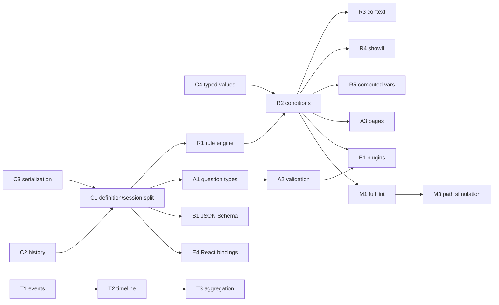

# Survey Skipper roadmap

Status: the first round (sections 1 to 5) is fully built. A second round of features was proposed on 2026-11-21 and
is tracked in section 6, in build order.

Goal of the project: **create, manage, track, share and extend customizable surveys whose path branches on rules and
context.** This plan maps that goal onto the library as it stands at v2.0.0 (strict TypeScript, PR #1).

## 1. Where the library is today

About 250 lines across `Answer`, `Question` and `Survey`.

What works well:

- Linear surveys with value-based jumps (`answerMap[from][value] = to`), plus a wildcard key for custom answers.
- Pre-answers: answering a later question now, so it is skipped but still routes.
- Batches of consecutive questions, loop protection, JSON round-trip through the constructor.
- A clean, framework-agnostic core with no runtime dependencies.

What limits it against the goal:

| Gap | Why it matters |
| --- | --- |
| Definition and response are one mutable object (`Survey` holds questions, rules, answers and the cursor `index`). | You can't run many respondents against one survey, version a survey, or store responses separately. Almost every other feature wants this split. |
| Branching is exact string equality on one answer. `1` and `"1"` collide; booleans become `1`/`0`. | No ranges, no "any of", no conditions on earlier answers, no external context (user role, locale, A/B bucket). This is the core promise of the project. |
| No history. `getNextQuestion` moves forward only and overwrites `index`. | No "Back" button, no record of the path a respondent took, nothing to track. |
| Questions have no type or validation; answers are single-valued. | No multi-select, numeric, rating, date or required questions. |
| No `toJSON`, no schema, no format version. Persistence relies on the constructor accepting its own fields. | Hard to share, store, or migrate surveys safely. |
| `getNextQuestions(n)` returns the next `n` by array order, ignoring branches inside the batch; only the last answer in `setAnswers` routes. | Batches (pages) can show questions a respondent should have skipped. |
| No way to check a survey: dangling targets fall back silently, unreachable questions go unnoticed. | Authoring mistakes reach respondents. |
| No events or hooks. | Nothing to plug analytics, storage or UI into. |

## 2. Proposed features

Grouped by the goal's verbs. Scope: **S** is about a day, **M** a few days, **L** a week or more.

### Core model (enables everything else)

| ID | Feature | Scope |
| --- | --- | --- |
| C1 | ✅ Built (3.0). **Split definition from session.** `SurveyDefinition` (questions, rules, answer map, settings, `version`) and `SurveySession` (answers, context, position, history, ending). `Survey` remains as a deprecated wrapper until 4.0. | L |
| C2 | **Navigation history.** ✅ Built. `history`, `back()`, `canGoBack()`, `getPath()`. Changing an earlier answer moves answers on the abandoned route to `abandonedAnswers` (default) or discards them (`keepAbandonedAnswers: false`). `goTo(id)` and `canGoTo(id)` jump along the respondent's route (3.6). | M |
| C3 | ✅ Built (3.0). **Serialization.** `toJSON()` on both classes with `schemaVersion` (1); constructors restore from it and reject newer schemas. Sessions record `definitionId` / `definitionVersion`. Not yet: migrations between schema versions. | S |
| C4 | ✅ Built (3.1). **Typed answer values.** Answers keep `string | number | boolean` or a list of them; booleans are no longer turned into 1/0. | S |

### Branching rules and context

| ID | Feature | Scope |
| --- | --- | --- |
| R1 | ✅ Built (2.2). **Rule engine.** Ordered `rules` on each question: `{ if?, goTo }` or `{ if?, end }`, first match wins; the `answerMap` still applies after rules, then the next question. Rules live on the current `Survey`; they move to `SurveyDefinition` with C1. | M |
| R2 | ✅ Built (2.2). **Condition language: JsonLogic** via `json-logic-js` (core's first runtime dependency). Data: `answer`, `answers.<id>`, `context.<key>`. Extra operators: `answered`, `matches`. YAML authoring in the `survey-skipper-yaml` package. The `skipped` operator arrived in round 2 (R9). | M |
| R3 | ✅ Built (2.2). **Context.** `context` on the survey, readable as `context.*`, replaceable mid-survey with `setContext()`. | S |
| R4 | ✅ Built (3.0). **Display conditions.** `showIf` and `skipIf`; routed-past questions keep their rules. The first question is checked lazily when the session is first read. | S |
| R5 | ✅ Built (3.4). **Computed variables.** `variables` on the definition, readable as `vars.*` in conditions and piped text; `getVariables()`. | M |
| R6 | ✅ Built (2.2). **End states.** `{ end: 'qualified' }` rules finish the survey and set `survey.ending`. | S |

### Create (authoring)

| ID | Feature | Scope |
| --- | --- | --- |
| A1 | ✅ Built (3.1). **Question types.** `single`, `multi`, `text`, `number`, `rating`, `date`, `boolean`. | M |
| A2 | ✅ Built (3.1). **Validation.** `required`, `min`/`max`, `minLength`/`maxLength`, `pattern`, `minSelected`/`maxSelected`. `session.answer()` returns errors and doesn't store invalid answers; `validate()` and `validateAnswer()` check without storing. Custom validators arrive with E1. | M |
| A3 | ✅ Built (3.2). **Sections / pages.** Questions take a `section`; `getPage()` follows the route the current answers lead to inside the section, and `nextPage()` moves past it. | M |
| A4 | ✅ Built (3.2). **Piping.** `{{answers.x}}`, `{{context.x}}`, `{{answer}}` in question text via `getQuestionText()` / `renderText()`. | S |
| A5 | ✅ Built (3.3). **Fluent builder.** `survey(id).question(id, options, q => q.goTo(...).end(...))` plus JsonLogic condition helpers (`eq`, `lt`, `oneOf`, `includes`, `and`...). Question ids are not type-inferred. | M |

### Manage

| ID | Feature | Scope |
| --- | --- | --- |
| M1 | ✅ Built (3.3). **Static analysis / lint.** `lintDefinition()`: duplicate ids, rule shape, unknown targets, unreachable rules and questions, unknown references, invalid regexes, choice questions without options. | M |
| M2 | ✅ Built (3.4). **Versioning.** Definitions carry `version`, sessions record it, and `migrateSession()` moves saved sessions to a new definition with a report. | M |
| M3 | ✅ Built (3.3). **Path simulation.** `simulatePaths()` lists structural routes; `runScript()` runs scripted answers through a real session. | M |

### Track

| ID | Feature | Scope |
| --- | --- | --- |
| T1 | ✅ Built (3.2). **Events.** `session.on()` for `answer`, `invalid`, `navigate`, `back`, `complete`; returns an unsubscribe function. | S |
| T2 | ✅ Built (3.4). **Response timeline.** `session.timeline` with `shown`, `answered`, `changed`, `skipped`, `back`, `complete` and ISO timestamps, saved with the session; injectable clock; `timeOnQuestions()`. | S |
| T3 | ✅ Built (3.4). **Aggregation helpers.** `aggregate()` over sessions or saved JSON: completion, endings, per-question shown/answered/drop-off and distributions, route frequency. | M |

### Share

| ID | Feature | Scope |
| --- | --- | --- |
| S1 | ✅ Built (3.3). **Published JSON Schema** at `survey-skipper/schema.json`. | S |
| S2 | ✅ Built (3.3). **Graph export.** `toMermaid()` and `toDot()`, on top of `getEdges()`. | S |
| S3 | ✅ Built (3.3). **Dual ESM + CJS build** for core and yaml. A pre-bundled browser file is not provided; bundlers consume the ESM build. | S |

### Extend

| ID | Feature | Scope |
| --- | --- | --- |
| E1 | ✅ Built (3.5). **Plugin registry.** `registerOperator`, `registerQuestionType`, `registerValidator` (used via `validation.custom`), `resetPlugins`. | M |
| E2 | ✅ Built (3.5). **Storage adapter interface.** Async `SurveyStore`, `MemoryStore`, `WebStorageStore` (localStorage), `resumeSession()`. | S |
| E3 | ✅ Built (3.5). **i18n.** Question and definition `translations`, `defaultLocale`, locale from `context.locale` with `fr-CA` to `fr` fallback; `getQuestionText`, `getAnswerText`, `getTitle`, `getDescription`. | M |
| E4 | ✅ Built (react 0.1). **UI bindings** as separate packages, starting with the React `useSurvey()` hook in `survey-skipper-react`. | L |

### Service and UI (decided: build all three, in one repo)

| ID | Feature | Scope |
| --- | --- | --- |
| P1 | ✅ Built. **pnpm workspace monorepo.** `packages/core` (published as `survey-skipper`), `packages/yaml`, `packages/react`, `apps/server`, `apps/web`. Shared tsconfig, eslint and CI. | M |
| SV1 | ✅ Built (server 0.1, `apps/server`). **Survey service.** HTTP API for definitions (CRUD, versions), sessions (start, answer, back) and responses, on top of E2 storage adapters. | L |
| UI1 | ✅ Built (`apps/web` 0.1). **Respondent UI.** Renders a session: question types, validation, Back, progress, with abandoned answers prefilled when a question comes round again. | L |
| UI2 | ✅ Built (`apps/web` 0.2, `#/builder`). **Builder UI.** Edit questions and JsonLogic/YAML rules, see the branching graph (S2) and lint results (M1) live. | L |

## 3. Phased build plan

Each phase ends in a release. Phases 1 and 2 are the heart of the project; later phases can be reordered to taste.

### Phase 1: Foundations (release 2.1, non-breaking)
**C4, C3, C2, M1 (basic), T1**

- Typed values, `toJSON`/`fromJSON` with `schemaVersion`, back navigation and history, a first `validateDefinition()`
  (dangling targets, unreachable questions), and events.
- All built on the current `Survey` so nothing breaks yet.
- Dependencies: none. Scope: about 1 to 1.5 weeks.
- Why first: cheap, immediately useful, and every later phase leans on history, events and serialization.

### Phase 2: Monorepo, rules and context (release 3.0, breaking)
**P1, C1, R1, R2, R3, R4, R6**

- Start with P1: move the library into `packages/core` under a pnpm workspace before the big rework, so later
  packages land in place.

- Introduce `SurveyDefinition` + `SurveySession`, the JSON condition language, context, display conditions and named
  endings. `answerMap` compiles to rules; `Survey` stays as a deprecated wrapper for one release.
- Dependencies: Phase 1 (history makes pruning on answer-change possible; serialization defines the new shapes).
- Scope: about 2 to 3 weeks. Highest value, highest risk: the condition format becomes a public contract, so it should
  be reviewed before code is written (a short design doc / ADR).

### Phase 3: Richer questions (3.1)
**A1, A2, A3, A4**

- Question types, validation, pages with correct in-page branching, piping.
- Dependencies: C1 and R2 (types feed operator checks; pages need the rule evaluator).
- Scope: about 2 weeks.

### Phase 4: Authoring and sharing (3.2)
**A5, S1, S2, S3, M1 (full), M3**

- Fluent builder, JSON Schema, graph export, ESM build, full linter and path simulation.
- Dependencies: the definition format must be stable (end of Phase 3). S3 can be pulled forward any time.
- Scope: about 1.5 to 2 weeks.

### Phase 5: Tracking and analytics (3.3)
**T2, T3, R5, M2**

- Timeline, aggregation helpers, computed variables and scoring, versioning.
- Dependencies: T1 (events), C1 (sessions as data). R5 needs R2.
- Scope: about 1.5 weeks.

### Phase 6: Ecosystem (3.x)
**E1, E2, E3, E4**

- Plugin registry (custom operators register into JsonLogic), storage adapters, i18n, React bindings.
- Dependencies: E1 needs R2 and A1/A2 to be extension points; E4 needs the session API settled.
- Scope: 2 weeks plus, mostly separable.

### Phase 7: Service and apps
**SV1, UI1, UI2**

- The service on storage adapters, then the respondent UI on the React bindings, then the builder.
- Dependencies: P1, E2, E4; UI2 also needs S2 and M1.
- Scope: several weeks; each app is its own track.

### Dependency sketch

## 4. Recommended first picks

If you only build three things, build these, in order:

1. **C2 history + back navigation** (built): the most visible gap for anyone using the library in a real form.
2. **R1 + R2 rule engine with JsonLogic conditions**: this is what "branching paths given a set of rules" means, and today
   it is limited to exact matches on one answer.
3. **R3 context**: unlocks "and context" from the goal with very little code once R2 exists.

C1 (the split) is the biggest structural change; doing it together with R1/R2 in one breaking release avoids two rounds
of churn for users.

## 5. Decisions (answered 2026-11-20)

1. **Breaking 3.0 release:** yes. The definition/session split (C1) ships in 3.0.
2. **Library, service or UI:** all three, in a pnpm monorepo (P1, SV1, UI1, UI2).
3. **Condition format:** JsonLogic, with YAML authoring support (R2).
4. **Answer changes:** keep answers on the abandoned route, marked as abandoned, with an option for survey creators to
   discard them instead (built in C2: `abandonedAnswers`, `keepAbandonedAnswers`).

## 6. Second round (proposed 2026-11-21)

The first round made the library, service and apps work end to end. The second round is about running real surveys
with them: getting results out, controlling when a survey takes responses, the question formats people expect from
survey tools, and connecting the service to other systems.

Items are listed in the order they will be built. IDs continue the first round's letters.

| # | ID | Feature | Where | Scope |
| --- | --- | --- | --- | --- |
| 1 | T4 | ✅ Built (core 3.7, server 0.3). **Response export.** `toRows()` / `toCSV()` in core turn sessions into one row per respondent (answers, ending, timings, abandoned answers optional). Server: `GET /definitions/:id/responses.csv` and `.json`. | core, server | S |
| 2 | M4 | ✅ Built (core 3.8, server 0.4). **Survey lifecycle.** Definitions get `status` (`draft`, `open`, `closed`), `opensAt` / `closesAt` and `maxResponses`. The server refuses new sessions outside that window and reports why; `isAcceptingResponses()` in core. | core, server | S |
| 3 | UI3 | ✅ Built (`apps/web` 0.3). **Results dashboard** at `#/results/<id>` in the web app: completion, endings, drop-off per question and answer distributions from the stats route, with a CSV download (T4). | web | M |
| 4 | A6 | ✅ Built (core 3.9). **Randomized order.** `randomize` on a question shuffles its options; `randomize` on a section shuffles its questions. Seeded per session so the order survives back, resume and reload; the seed is saved with the session. | core, web | M |
| 5 | R7 | ✅ Built (core 3.10). **Scoring.** `score` on answer options; `getScore()` on the session, `score` readable in conditions and piped text, and score totals in `aggregate()`. Quizzes and lead scoring without hand-written variables. | core | S |
| 6 | A7 | ✅ Built (core 3.11). **Carry-forward options.** `answersFrom: { question, include: 'selected' \| 'unselected' }` builds a question's options from an earlier multi-select answer. | core, web | S |
| 7 | A8 | ✅ Built (core 3.12). **Ranking and matrix questions.** `ranking` (order all options) and `matrix` (rows rated on shared columns, answer is an object by row). Validation, lint, aggregation and UI support. | core, web | M |
| 8 | R8 | ✅ Built (core 3.13, server 0.7). **Quotas.** `quotas: [{ id, if, limit, end }]` on the definition. The server counts completed sessions per quota and passes the counts to sessions as `quotaCounts` (not context, so respondents cannot change them); a session that would land in a full quota ends with the quota's ending. | core, server | M |
| 9 | SV2 | ✅ Built (server 0.8). **Webhooks.** Server option to POST session events (`complete`, optionally `answer`) to configured URLs, signed with an HMAC header, with retries. | server | S |
| 10 | S4 | ✅ Built (`apps/web` 0.5). **Embedding and share links.** `#/embed/<id>` renders a survey without the app chrome and posts `survey-skipper:complete` to the parent window; the builder shows a share link and an iframe snippet. | web | S |
| 11 | R9 | ✅ Built (core 3.14). **`skipped` operator** (left over from R2): true when a question was routed past, so later rules can react to it. | core | S |
| 12 | M5 | **Definition diff.** `diffDefinitions(a, b)` lists added, removed and changed questions, options and rules; the builder shows the diff against the saved version before saving. | core, web | M |

### Phases

- **Phase 8, results and lifecycle:** T4, M4, UI3. Makes the hosted service usable for a real survey.
- **Phase 9, question formats:** A6, R7, A7, A8, R9 (core 3.7 and on).
- **Phase 10, integration:** R8, SV2, S4, M5.

None of these needs a breaking change. Each item ships as its own PR and is merged once CI is green.
