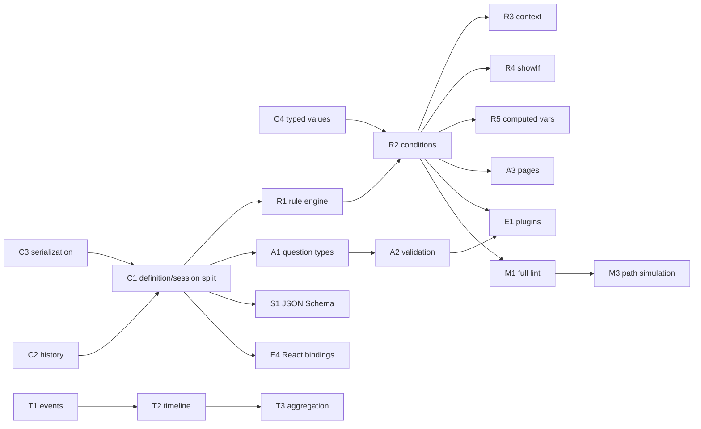

# Survey Skipper roadmap

Status: proposal, nothing here is built yet. Pick the items you want and each becomes its own PR.

Goal of the project: **create, manage, track, share and extend customizable surveys whose path branches on rules and
context.** This plan maps that goal onto the library as it stands at v2.0.0 (strict TypeScript, PR #1).

## 1. Where the library is today

About 250 lines across `Answer`, `Question` and `Survey`.

What works well:

- Linear surveys with value-based jumps (`answerMap[from][value] = to`), plus a wildcard key for custom answers.
- Pre-answers: answering a later question now, so it is skipped but still routes.
- Batches of consecutive questions, loop protection, JSON round-trip through the constructor.
- A clean, framework-agnostic core with no runtime dependencies.

What limits it against the goal:

| Gap | Why it matters |
| --- | --- |
| Definition and response are one mutable object (`Survey` holds questions, rules, answers and the cursor `index`). | You can't run many respondents against one survey, version a survey, or store responses separately. Almost every other feature wants this split. |
| Branching is exact string equality on one answer. `1` and `"1"` collide; booleans become `1`/`0`. | No ranges, no "any of", no conditions on earlier answers, no external context (user role, locale, A/B bucket). This is the core promise of the project. |
| No history. `getNextQuestion` moves forward only and overwrites `index`. | No "Back" button, no record of the path a respondent took, nothing to track. |
| Questions have no type or validation; answers are single-valued. | No multi-select, numeric, rating, date or required questions. |
| No `toJSON`, no schema, no format version. Persistence relies on the constructor accepting its own fields. | Hard to share, store, or migrate surveys safely. |
| `getNextQuestions(n)` returns the next `n` by array order, ignoring branches inside the batch; only the last answer in `setAnswers` routes. | Batches (pages) can show questions a respondent should have skipped. |
| No way to check a survey: dangling targets fall back silently, unreachable questions go unnoticed. | Authoring mistakes reach respondents. |
| No events or hooks. | Nothing to plug analytics, storage or UI into. |

## 2. Proposed features

Grouped by the goal's verbs. Scope: **S** is about a day, **M** a few days, **L** a week or more.

### Core model (enables everything else)

| ID | Feature | Scope |
| --- | --- | --- |
| C1 | **Split definition from session.** `SurveyDefinition` (immutable: questions, rules, metadata, version) and `SurveySession` (one respondent: answers, context, cursor, history). Keep `Survey` as a thin compatibility wrapper for one 2.x minor, then remove in 3.0. | L |
| C2 | **Navigation history.** Session records the visited path; `back()`, `goTo(id)` that respects reachability, `canGoBack()`. Changing an earlier answer prunes answers on paths no longer reachable (configurable: prune or keep). | M |
| C3 | **Serialization.** `toJSON()` / `fromJSON()` for both definition and session, with a `schemaVersion` field and a migration hook. | S |
| C4 | **Typed answer values.** Preserve `string | number | boolean | string[] | null` instead of stringifying; answer keys stop colliding. | S |

### Branching rules and context

| ID | Feature | Scope |
| --- | --- | --- |
| R1 | **Rule engine.** Ordered rules per question: `{ when: Condition, goTo: questionId | 'END' }`, first match wins, then a `default`. The current `answerMap` compiles into rules, so old surveys keep working. | M |
| R2 | **Condition language** as plain JSON (shareable, storable): `eq`, `neq`, `in`, `notIn`, `gt/gte/lt/lte`, `between`, `contains`, `matches` (regex), `answered`, `skipped`, combined with `all` / `any` / `not`. Conditions can reference any earlier answer, not just the current question. | M |
| R3 | **Context.** A session takes a `context` object (role, locale, plan, experiment bucket...). Conditions read it via `{ var: 'context.role' }`. Context can change mid-session. | S |
| R4 | **Display conditions.** `showIf` / `skipIf` on a question, evaluated when the session reaches it. Many surveys are easier to write this way than as jumps. | S |
| R5 | **Computed variables and scoring.** Named expressions (`score = sum of answers in section A`) usable in conditions, piping and results. | M |
| R6 | **End states.** Multiple named endings (`qualified`, `screened_out`) reachable from rules, returned on completion. | S |

### Create (authoring)

| ID | Feature | Scope |
| --- | --- | --- |
| A1 | **Question types.** `single`, `multi`, `text`, `number`, `rating`, `date`, `boolean`, each with typed answer values and options. | M |
| A2 | **Validation.** `required`, `min`/`max`, `minSelected`/`maxSelected`, `pattern`, custom validators. `session.answer()` returns errors instead of silently storing junk. | M |
| A3 | **Sections / pages.** Group questions; `getNextPage()` evaluates branching inside the page so batches are correct (replaces `getNextQuestions(n)`). | M |
| A4 | **Piping.** Templates in question text: `"How long have you owned your {{answers.make}}?"`, resolved per session. | S |
| A5 | **Fluent builder.** `survey('id').question('car', q => q.single(['yes','no'])).when(eq('car','no')).goTo('commute')` with full type inference. | M |

### Manage

| ID | Feature | Scope |
| --- | --- | --- |
| M1 | **Static analysis / lint.** `validateDefinition()` reports dangling targets, unreachable questions, cycles, conditions referencing later or unknown questions, type mismatches (`gt` on a text question). | M |
| M2 | **Versioning.** Definitions carry a version; sessions record which version they ran against; a helper maps answers across versions by question id. | M |
| M3 | **Path simulation.** Enumerate every possible path (or sample them) for testing: "can a respondent reach `screened_out` without answering `age`?" | M |

### Track

| ID | Feature | Scope |
| --- | --- | --- |
| T1 | **Events.** `onAnswer`, `onNavigate`, `onBack`, `onComplete`, `onValidationError` on the session; plain listener API, no dependency. | S |
| T2 | **Response timeline.** Session keeps timestamped events (shown, answered, changed, skipped), so time-per-question and edits are recoverable. | S |
| T3 | **Aggregation helpers.** Given many sessions: answer distributions, completion and drop-off per question, path frequency (which branches people actually take). Pure functions over session JSON. | M |

### Share

| ID | Feature | Scope |
| --- | --- | --- |
| S1 | **Published JSON Schema** for the definition format, so other tools and languages can author and validate surveys. | S |
| S2 | **Graph export.** Definition to Mermaid / Graphviz DOT, for docs and reviews of branching logic. | S |
| S3 | **Dual ESM + CJS build** and a browser-friendly bundle. | S |

### Extend

| ID | Feature | Scope |
| --- | --- | --- |
| E1 | **Plugin registry.** Register custom condition operators, question types and validators (`registerOperator('withinRadius', fn)`). | M |
| E2 | **Storage adapter interface.** `load/save` for sessions and definitions, with an in-memory adapter and a `localStorage` example. Back-ends stay out of core. | S |
| E3 | **i18n.** Per-locale text for questions and options, chosen from context. | M |
| E4 | **UI bindings** as separate packages, starting with a React `useSurvey()` hook. | L |

## 3. Phased build plan

Each phase ends in a release. Phases 1 and 2 are the heart of the project; later phases can be reordered to taste.

### Phase 1: Foundations (release 2.1, non-breaking)
**C4, C3, C2, M1 (basic), T1**

- Typed values, `toJSON`/`fromJSON` with `schemaVersion`, back navigation and history, a first `validateDefinition()`
  (dangling targets, unreachable questions), and events.
- All built on the current `Survey` so nothing breaks yet.
- Dependencies: none. Scope: about 1 to 1.5 weeks.
- Why first: cheap, immediately useful, and every later phase leans on history, events and serialization.

### Phase 2: Rules and context (release 3.0, breaking)
**C1, R1, R2, R3, R4, R6**

- Introduce `SurveyDefinition` + `SurveySession`, the JSON condition language, context, display conditions and named
  endings. `answerMap` compiles to rules; `Survey` stays as a deprecated wrapper for one release.
- Dependencies: Phase 1 (history makes pruning on answer-change possible; serialization defines the new shapes).
- Scope: about 2 to 3 weeks. Highest value, highest risk: the condition format becomes a public contract, so it should
  be reviewed before code is written (a short design doc / ADR).

### Phase 3: Richer questions (3.1)
**A1, A2, A3, A4**

- Question types, validation, pages with correct in-page branching, piping.
- Dependencies: C1 and R2 (types feed operator checks; pages need the rule evaluator).
- Scope: about 2 weeks.

### Phase 4: Authoring and sharing (3.2)
**A5, S1, S2, S3, M1 (full), M3**

- Fluent builder, JSON Schema, graph export, ESM build, full linter and path simulation.
- Dependencies: the definition format must be stable (end of Phase 3). S3 can be pulled forward any time.
- Scope: about 1.5 to 2 weeks.

### Phase 5: Tracking and analytics (3.3)
**T2, T3, R5, M2**

- Timeline, aggregation helpers, computed variables and scoring, versioning.
- Dependencies: T1 (events), C1 (sessions as data). R5 needs R2.
- Scope: about 1.5 weeks.

### Phase 6: Ecosystem (3.x, as needed)
**E1, E2, E3, E4**

- Plugin registry, storage adapters, i18n, React bindings.
- Dependencies: E1 needs R2 and A1/A2 to be extension points; E4 needs the session API settled.
- Scope: 2 weeks plus, mostly separable.

### Dependency sketch

## 4. Recommended first picks

If you only build three things, build these, in order:

1. **C2 history + back navigation**: the most visible gap for anyone using the library in a real form.
2. **R1 + R2 rule engine with JSON conditions**: this is what "branching paths given a set of rules" means, and today
   it is limited to exact matches on one answer.
3. **R3 context**: unlocks "and context" from the goal with very little code once R2 exists.

C1 (the split) is the biggest structural change; doing it together with R1/R2 in one breaking release avoids two rounds
of churn for users.

## 5. Decisions needed before Phase 2

1. **Is a 3.0 breaking release acceptable**, or must the `Survey` API stay as is (we'd layer sessions on top instead)?
2. **Library only, or also a service/UI?** This plan keeps core as a dependency-free library and puts storage and UI in
   adapters/packages. "Manage" and "share" could instead mean a hosted app, which is a much larger project.
3. **Condition format:** custom JSON (proposed, small and typed) or adopt an existing one such as JsonLogic (more
   tooling, looser typing).
4. **Answer-change behaviour:** when an earlier answer changes and the path moves, should answers on the abandoned path
   be deleted or kept hidden?
